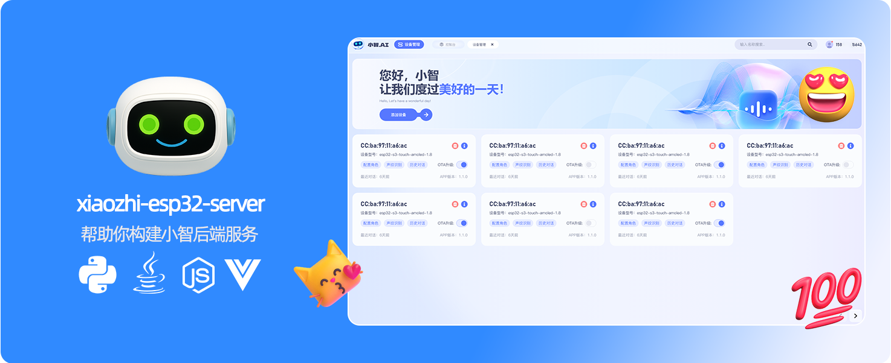
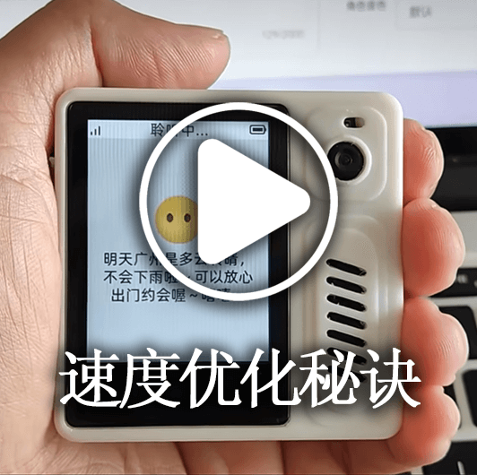
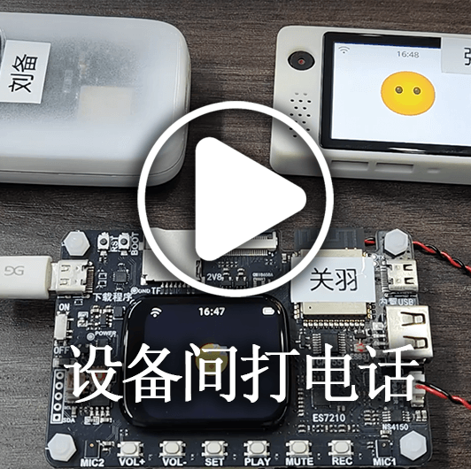
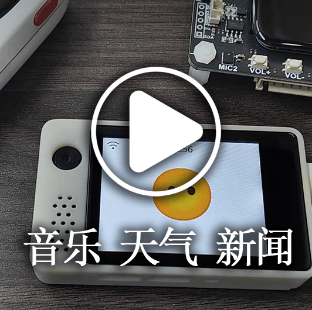
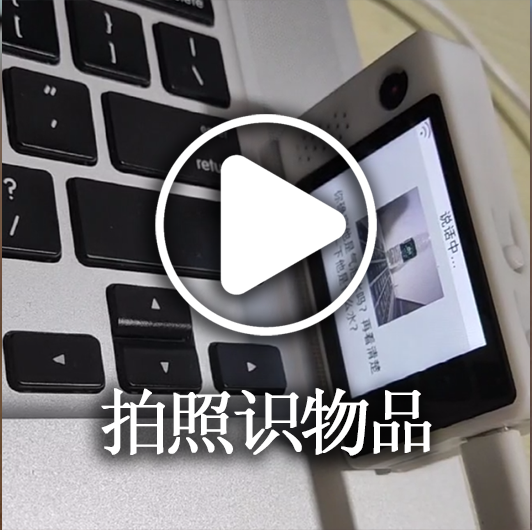
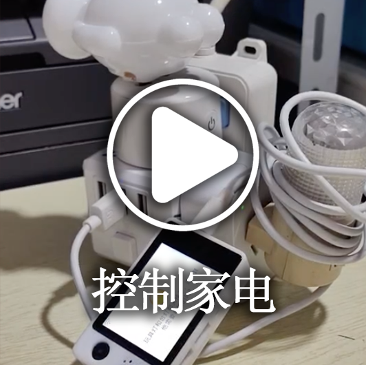
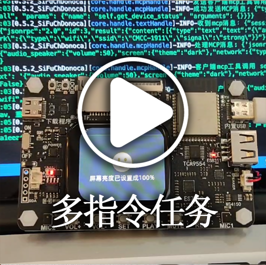
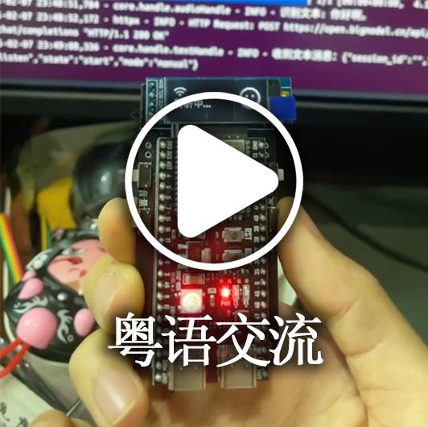

[](https://github.com/xinnan-tech/xiaozhi-esp32-server)

<h1 align="center">XiaoZhi Backend Service xiaozhi-esp32-server</h1>

<p align="center">
This project develops an intelligent terminal hardware and software system based on the theory and technology of human-machine symbiotic intelligence<br/>It provides backend services for the open-source intelligent hardware project
<a href="https://github.com/78/xiaozhi-esp32">xiaozhi-esp32</a><br/>
Implemented in Python, Java, and Vue according to the <a href="https://ccnphfhqs21z.feishu.cn/wiki/M0XiwldO9iJwHikpXD5cEx71nKh">XiaoZhi Communication Protocol</a><br/>
Supports the MQTT+UDP protocol, WebSocket protocol, MCP access point, voiceprint recognition, and knowledge base
</p>

<p align="center">
<a href="./docs/FAQ.md">FAQ</a>
· <a href="https://github.com/xinnan-tech/xiaozhi-esp32-server/issues">Report Issues</a>
· <a href="./README.md#deployment-documentation">Deployment Documentation</a>
· <a href="https://github.com/xinnan-tech/xiaozhi-esp32-server/releases">Release Notes</a>
</p>

<p align="center">
  <a href="./README.md"></a>
  <a href="./docs/readme/README_en.md"></a>
  <a href="./docs/readme/README_vi.md"></a>
  <a href="./docs/readme/README_de.md"></a>
  <a href="./docs/readme/README_pt_BR.md"></a>
  <a href="https://github.com/xinnan-tech/xiaozhi-esp32-server/releases">
    
  </a>
  <a href="https://github.com/xinnan-tech/xiaozhi-esp32-server/blob/main/LICENSE">
    
  </a>
  <a href="https://github.com/xinnan-tech/xiaozhi-esp32-server">
    
  </a>
</p>

<p align="center">
Spearheaded by Professor Siyuan Liu's Team (South China University of Technology)
</br>
Research and development led by Professor Siyuan Liu's team (South China University of Technology)
</br>

</p>

---

## Target Audience 👥

This project must be used together with ESP32 hardware devices. If you have already purchased ESP32-related hardware, successfully connected it to the backend service deployed by Brother Xia, and want to build your own `xiaozhi-esp32` backend service independently, then this project is a perfect fit for you.

Want to see how it works? Check out the videos below 🎥

<table>
  <tr>
    <td>
      <a href="https://www.bilibili.com/video/BV1FMFyejExX" target="_blank">
        <picture>
          </picture>
      </a>
    </td>
    <td>
      <a href="https://www.bilibili.com/video/BV1vchQzaEse" target="_blank">
        <picture>
          </picture>
      </a>
    </td>
    <td>
      <a href="https://www.bilibili.com/video/BV1WEcxzFEAT" target="_blank">
        <picture>
          </picture>
      </a>
    </td>
    <td>
      <a href="https://www.bilibili.com/video/BV1CKVz6UEuB" target="_blank">
        <picture>
          </picture>
      </a>
    </td>
    <td>
      <a href="https://www.bilibili.com/video/BV1C1tCzUEZh" target="_blank">
        <picture>
          </picture>
      </a>
    </td>
  </tr>
  <tr>
    <td>
      <a href="https://www.bilibili.com/video/BV1VC96Y5EMH" target="_blank">
        <picture>
          </picture>
      </a>
    </td>
    <td>
      <a href="https://www.bilibili.com/video/BV12J7WzBEaH" target="_blank">
        <picture>
          </picture>
      </a>
    </td>
    <td>
      <a href="https://www.bilibili.com/video/BV1Co76z7EvK" target="_blank">
        <picture>
          </picture>
      </a>
    </td>
    <td>
      <a href="https://www.bilibili.com/video/BV1pNXWYGEx1" target="_blank">
        <picture>
          </picture>
      </a>
    </td>
    <td>
      <a href="https://www.bilibili.com/video/BV1TJ7WzzEo6" target="_blank">
        <picture>
          </picture>
      </a>
    </td>
  </tr>
  <tr>
    <td>
      <a href="https://www.bilibili.com/video/BV1ZQKUzYExM" target="_blank">
        <picture>
          </picture>
      </a>
    </td>
    <td>
      <a href="https://www.bilibili.com/video/BV1zUW5zJEkq" target="_blank">
        <picture>
          </picture>
      </a>
    </td>
    <td>
      <a href="https://www.bilibili.com/video/BV1Exu3zqEDe" target="_blank">
        <picture>
          </picture>
      </a>
    </td>
    <td>
      <a href="https://www.bilibili.com/video/BV1CDKWemEU6" target="_blank">
        <picture>
          </picture>
      </a>
    </td>
    <td>
      <a href="https://www.bilibili.com/video/BV12yA2egEaC" target="_blank">
        <picture>
          </picture>
      </a>
    </td>
  </tr>
</table>

---

## Warning ⚠️

1. This project is open-source software. It has no commercial partnership with any third-party API provider it integrates with (including but not limited to ASR, LLM, and TTS platforms) and provides no guarantee of any kind regarding their service quality or the safety of your funds. Users are advised to choose providers holding the relevant business licenses and to read their terms of service and privacy policies carefully. This software does not store any account keys, participate in fund transfers, or bear the risk of losses from top-ups.

2. This project is still under development and has not passed cybersecurity assessment. Do not use it in production. If you deploy it on the public internet for learning purposes, be sure to implement the necessary protections.

---

## Deployment Documentation


This project offers two deployment approaches. Choose the one that best suits your needs:

#### 🚀 Deployment Options
| Deployment Method | Features | Use Cases | Deployment Guide | Requirements | Video Tutorial | 
|---------|------|---------|---------|---------|---------|
| **Minimal Installation** | Intelligent conversation, single-agent management | Low-spec environments; data stored in configuration files; no database required | [①Docker](./docs/Deployment.md#method-1-docker-server-only) / [②Source Code Deployment](./docs/Deployment.md#method-2-local-source-code-server-only)| 2 cores / 4 GB with `FunASR`; 2 cores / 2 GB with an all-API setup | - | 
| **Full-Module Installation** | Intelligent conversation, multi-user management, multi-agent management, Control Panel UI | Complete feature experience; data stored in a database |[①Docker](./docs/Deployment_all.md#method-1-docker-all-modules) / [②Source Code Deployment](./docs/Deployment_all.md#method-2-local-source-code-all-modules) / [③Source Code Deployment Auto-Update Tutorial](./docs/dev-ops-integration.md) | 4 cores / 8 GB with `FunASR`; 2 cores / 4 GB with an all-API setup| [Local Source Code Startup Video Tutorial](https://www.bilibili.com/video/BV1wBJhz4Ewe) | 

For FAQs and related tutorials, see [this link](./docs/FAQ.md).

> 💡 Tip: Below is the test platform deployed with the latest code. You can flash the firmware and try it out if needed. It supports 6 concurrent connections, and data is cleared every day.

```
Control Panel URL: https://2662r3426b.vicp.fun
Control Panel (H5 version): https://2662r3426b.vicp.fun/h5/index.html

Service testing tool: https://2662r3426b.vicp.fun/test/
OTA endpoint: https://2662r3426b.vicp.fun/xiaozhi/ota/
WebSocket endpoint: wss://2662r3426b.vicp.fun/xiaozhi/v1/
```

#### 🚩 Configuration Guide and Recommendations
> [!Note]
> This project offers two configuration profiles:
> 
> 1. `Free Starter` configuration: suitable for personal and home use; all components use free options, with no extra cost.
> 
> 2. `Streaming` configuration: suitable for demos, training, and scenarios with more than two concurrent sessions; it uses streaming technology for faster responses and a better experience.
> 
> Since version `0.5.2`, the project has supported streaming configurations. Compared with earlier versions, response speed has improved by about `2.5 seconds`, significantly enhancing the user experience.

| Module | Free Starter Setup | Streaming Setup |
|:---:|:---:|:---:|
| ASR (Speech Recognition) | FunASR (local) | 👍XunfeiStreamASR (iFlytek streaming) |
| LLM | glm-4-flash (Zhipu) | 👍qwen-flash (Alibaba Cloud Bailian) |
| VLLM (Vision LLM) | glm-4v-flash (Zhipu) | 👍qwen3.5-flash (Alibaba Cloud Bailian) |
| TTS (Speech Synthesis) | EdgeTTS (Microsoft) | 👍HuoshanDoubleStreamTTS (Volcano Engine streaming) |
| Intent | function_call (function calling) | function_call (function calling) |
| Memory | mem_local_short (local short-term memory) | mem_local_short (local short-term memory) |

If you care about the latency of each component, see the [XiaoZhi component performance test report](https://github.com/xinnan-tech/xiaozhi-performance-research); you can test in your own environment using the methodology described there.

#### 🔧 Testing Tools
This project provides the following testing tools to help you validate the system and choose suitable models:

| Tool | Location | Usage | Description |
|:---:|:---|:---:|:---:|
| Audio Interaction Test Tool | main > digital-human > index.html | Run `python start.py` in `main/digital-human`, then open `http://127.0.0.1:8006/index.html` | Test audio playback and reception to verify that audio processing on the Python side works correctly |
| Model Response Test Tool | main > xiaozhi-server > performance_tester.py | Run `python performance_tester.py` | Test the response latency of core modules such as ASR (speech recognition), LLM, VLLM (vision model), and TTS (speech synthesis) |

> 💡 Tip: When testing model latency, only models with configured API keys are tested.

---
## Feature List ✨
### Implemented ✅

| Feature Module | Description |
|:---:|:---|
| Core Architecture | Based on the [MQTT+UDP gateway](https://github.com/xinnan-tech/xiaozhi-esp32-server/blob/main/docs/mqtt-gateway-integration.md), WebSocket, and HTTP servers, providing complete console management and authentication |
| Voice Interaction | Supports streaming ASR, streaming TTS, and VAD, with multilingual recognition and voice processing |
| Voiceprint Recognition | Supports multi-user voiceprint enrollment, management, and recognition; runs in parallel with ASR, identifies the speaker in real time, and passes the identity to the LLM for personalized responses |
| Intelligent Conversation | Supports multiple LLMs for intelligent conversation |
| Visual Perception | Supports multiple VLLMs for multimodal interaction |
| Intent Recognition | Supports external LLM-based intent recognition and autonomous LLM function calling, with a plugin-based intent handling mechanism |
| Memory System | Supports local short-term memory, mem0ai API memory, and PowerMem intelligent memory, with memory summarization |
| Knowledge Base | Supports RAGFlow knowledge bases, letting the LLM decide when to consult the knowledge base before answering |
| Tool Calling | Supports the client IoT protocol, client MCP protocol, server MCP protocol, MCP access point protocol, and custom tool functions |
| Command Dispatch | Leveraging MQTT, dispatches MCP commands from the Control Panel to ESP32 devices |
| Admin Console | Provides a web management UI for user management, system configuration, and device management; the UI supports Simplified Chinese, Traditional Chinese, and English |
| Testing Tools | Provides a performance testing tool, a vision model testing tool, and an audio interaction testing tool |
| Deployment Support | Supports Docker and local deployment, with complete configuration file management |
| Plugin System | Supports feature plugin extensions, custom plugin development, and plugin hot reloading |

### In Development 🚧

To learn about the development roadmap and progress, [click here](https://github.com/users/xinnan-tech/projects/3). For FAQs and related tutorials, see [this link](./docs/FAQ.md).

If you are a software developer, there is an [Open Letter to Developers](docs/contributor_open_letter.md). Welcome aboard!

---

## Product Ecosystem 👬
XiaoZhi is an ecosystem. While using this product, you can also explore other [outstanding projects](https://github.com/78/xiaozhi-esp32/blob/main/README_zh.md#%E7%9B%B8%E5%85%B3%E5%BC%80%E6%BA%90%E9%A1%B9%E7%9B%AE) in this ecosystem.

---

## Supported Platforms/Components 📋
### LLM

| Integration Method | Supported Platforms | Free Platforms |
|:---:|:---:|:---:|
| OpenAI API | Alibaba Cloud Bailian, Volcano Engine, DeepSeek, Zhipu, Gemini, iFlytek | Zhipu, Gemini |
| Ollama API | Ollama | - |
| Dify API | Dify | - |
| FastGPT API | FastGPT | - |
| Coze API | Coze | - |
| Xinference API | Xinference | - |
| Home Assistant API | HomeAssistant | - |

In practice, any LLM that supports OpenAI-compatible API calls can be integrated.

---

### VLLM (Vision Model)

| Integration Method | Supported Platforms | Free Platforms |
|:---:|:---:|:---:|
| OpenAI API | Alibaba Cloud Bailian, Zhipu ChatGLMVLLM | Zhipu ChatGLMVLLM |

In practice, any VLLM that supports OpenAI-compatible API calls can be integrated.

---

### TTS (Speech Synthesis)

| Integration Method | Supported Platforms | Free Platforms |
|:---:|:---:|:---:|
| API | EdgeTTS, iFlytek, Volcano Engine, Tencent Cloud, Alibaba Cloud and Bailian, CosyVoiceSiliconflow, TTS302AI, CozeCnTTS, GizwitsTTS, ACGNTTS, OpenAITTS, Lingxi Streaming TTS, MinimaxTTS | Lingxi Streaming TTS, EdgeTTS, CosyVoiceSiliconflow (partial) |
| Local Service | FishSpeech, GPT_SOVITS_V2, GPT_SOVITS_V3, Index-TTS, PaddleSpeech | Index-TTS, PaddleSpeech, FishSpeech, GPT_SOVITS_V2, GPT_SOVITS_V3 |

---

### VAD (Voice Activity Detection)

| Type  |   Platform   | Integration Method | Pricing | Notes |
|:---:|:---------:|:----:|:----:|:--:|
| VAD | SileroVAD | Local |  Free  |    |

---

### ASR (Speech Recognition)

| Integration Method | Supported Platforms | Free Platforms |
|:---:|:---:|:---:|
| Local | FunASR, SherpaASR | FunASR, SherpaASR |
| API | FunASRServer, Volcano Engine, iFlytek, Tencent Cloud, Alibaba Cloud, Baidu Cloud, OpenAI ASR | FunASRServer |

---

### Voiceprint Recognition

| Integration Method | Supported Platforms | Free Platforms |
|:---:|:---:|:---:|
| Local | 3D-Speaker | 3D-Speaker |

---

### Memory Storage

|   Type   |      Platform       | Integration Method |   Pricing   | Notes |
|:------:|:---------------:|:----:|:---------:|:--:|
| Memory |     mem0ai      | API | 1,000 calls/month quota |    |
| Memory |     [powermem](./docs/powermem-integration.md)    | Local summarization | Depends on LLM and DB |  Open source by OceanBase, supports intelligent retrieval  |
| Memory | mem_local_short | Local summarization |    Free     |    |
| Memory |     nomem       | No-memory mode |    Free     |    |

---

### Intent Recognition

|   Type   |     Platform      | Integration Method |  Pricing   |          Notes           |
|:------:|:-------------:|:----:|:-------:|:---------------------:|
| Intent |  intent_llm   | API | Billed by LLM |    Recognizes intent via LLM; highly general-purpose     |
| Intent | function_call | API | Billed by LLM | Completes intents through LLM function calling; fast and effective |
| Intent |    nointent   | No-intent mode |    Free     |    Skips intent recognition and returns the conversation result directly     |

---

### RAG (Retrieval-Augmented Generation)

|   Type   |     Platform      | Integration Method |  Pricing   |          Notes           |
|:------:|:-------------:|:----:|:-------:|:---------------------:|
| RAG |  ragflow   | API | Charged by tokens consumed for chunking and tokenization |    Uses RagFlow's retrieval-augmented generation for more accurate replies     |

---

## Acknowledgements 🙏

| Logo | Project/Company | Description |
|:---:|:---:|:---|
|  | [Bailing Voice Dialogue Robot](https://github.com/wwbin2017/bailing) | This project was inspired by the [Bailing Voice Dialogue Robot](https://github.com/wwbin2017/bailing) and built upon it |
|  | [Tenclass](https://www.tenclass.com/) | Thanks to [Tenclass](https://www.tenclass.com/) for defining the standard communication protocol, multi-device compatibility scheme, and high-concurrency best practices for the XiaoZhi ecosystem, and for providing full-link technical documentation support for this project |
|  | [Xuanfeng Technology](https://github.com/Eric0308) | Thanks to [Xuanfeng Technology](https://github.com/Eric0308) for contributing the implementation of the function calling framework, MCP communication protocol, and plugin-based invocation mechanism; its standardized command scheduling system and dynamic extension capabilities significantly improve the interaction efficiency and functional extensibility of front-end devices (IoT) |
|  | [huangjunsen](https://github.com/huangjunsen0406) | Thanks to [huangjunsen](https://github.com/huangjunsen0406) for contributing the `Control Panel mobile` module, enabling efficient control and real-time interaction on cross-platform mobile devices and greatly improving ease of operation and management efficiency in mobile scenarios |
|  | [Huiyuan Design](http://ui.kwd988.net/) | Thanks to [Huiyuan Design](http://ui.kwd988.net/) for providing professional visual solutions for this project, bringing its practical design experience serving over a thousand enterprises to enhance the product's user experience |
|  | [Xi'an Qinren Information Technology](https://www.029app.com/) | Thanks to [Xi'an Qinren Information Technology](https://www.029app.com/) for refining the project's visual system and ensuring consistency and extensibility of the overall design style across multiple scenarios |
|  | [Code Contributors](https://github.com/xinnan-tech/xiaozhi-esp32-server/graphs/contributors) | Thanks to [all code contributors](https://github.com/xinnan-tech/xiaozhi-esp32-server/graphs/contributors); your efforts make the project more robust and powerful. |


<a href="https://www.star-history.com/?repos=xinnan-tech%2Fxiaozhi-esp32-server&type=date&legend=top-left">
 <picture>
   <source media="(prefers-color-scheme: dark)" srcset="https://api.star-history.com/chart?repos=xinnan-tech/xiaozhi-esp32-server&type=date&theme=dark&legend=top-left&sealed_token=cQovHKgZjqEnQ-svfYfN392irNvGuq-6pyv4cA8nd2jQEhQLz1ETV4YHTVk2UZyLMFbCQuZA7jduRh3YbeK5WPYaRLrfmIimGQa3lram652jJL9oQk-UuSZA5H6L4dPIhZc8KCc-Ur_UAUNbly7TePpnTR2otGknBLCOjOliD4fk1st6z7tPEDVjSRx5" />
   <source media="(prefers-color-scheme: light)" srcset="https://api.star-history.com/chart?repos=xinnan-tech/xiaozhi-esp32-server&type=date&legend=top-left&sealed_token=cQovHKgZjqEnQ-svfYfN392irNvGuq-6pyv4cA8nd2jQEhQLz1ETV4YHTVk2UZyLMFbCQuZA7jduRh3YbeK5WPYaRLrfmIimGQa3lram652jJL9oQk-UuSZA5H6L4dPIhZc8KCc-Ur_UAUNbly7TePpnTR2otGknBLCOjOliD4fk1st6z7tPEDVjSRx5" />
   
 </picture>
</a>
