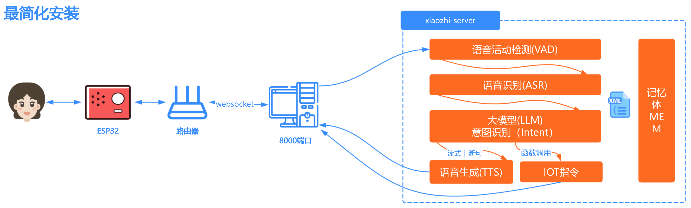
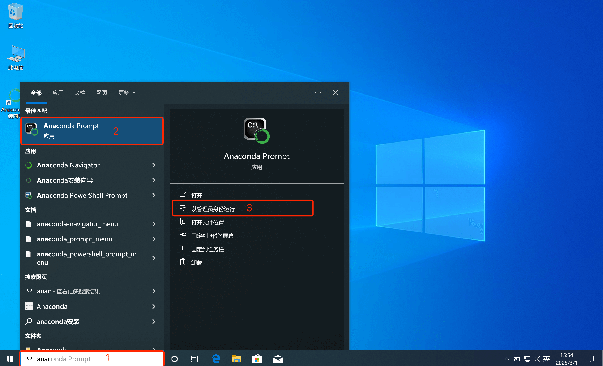
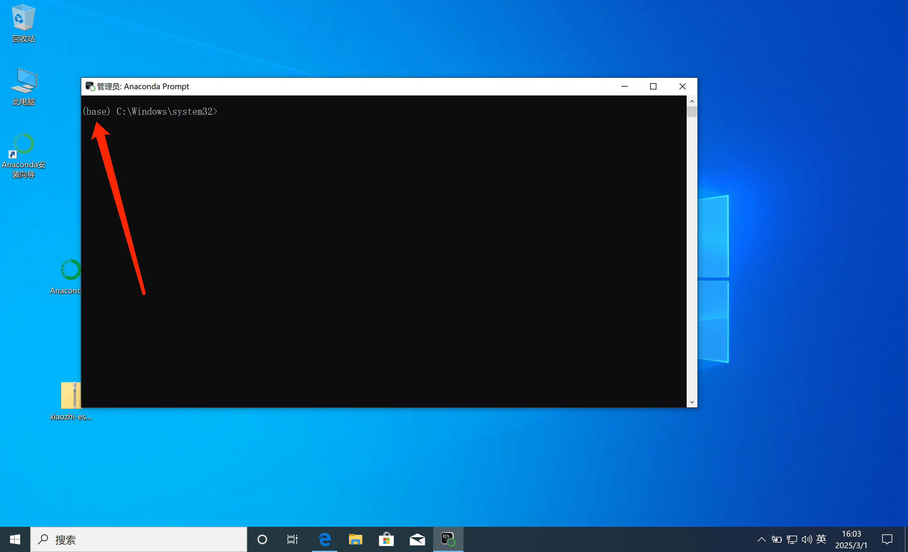

# Deployment Architecture Diagram

# Method 1: Docker (Server Only)

Starting with version `0.8.2`, the Docker images released for this project support only the `x86 architecture`. If you need to deploy on an `arm64` CPU, you can follow [this tutorial](docker-build.md) to build an `arm64 image` locally.

## 1. Install Docker

If Docker is not installed on your computer, you can follow the tutorial here: [Docker installation](https://www.runoob.com/docker/ubuntu-docker-install.html)

After installing Docker, continue below.

### 1.1 Manual Deployment

#### 1.1.1 Create Directories

After installing Docker, choose a directory to hold this project's configuration files. For example, you can create a folder named `xiaozhi-server`.

After creating the directory, create a `data` folder and a `models` folder inside `xiaozhi-server`, and create a `SenseVoiceSmall` folder inside `models`.

The final directory structure looks like this:

```
xiaozhi-server
  ├─ data
  ├─ models
     ├─ SenseVoiceSmall
```

#### 1.1.2 Download the Speech Recognition Model Files

You need to download the speech recognition model files, because the default speech recognition in this project uses a local offline recognition solution. You can download them here:
[Jump to download the speech recognition model files](#model-files)

After downloading, return to this tutorial.

#### 1.1.3 Download the Configuration Files

You need to download two configuration files: `docker-compose.yaml` and `config.yaml`. Download them from the project repository.

##### 1.1.3.1 Download docker-compose.yaml

Open [this link](../main/xiaozhi-server/docker-compose.yml) in a browser.

On the right side of the page, find the button labeled `RAW`. Next to the `RAW` button, find the download icon and click it to download the `docker-compose.yml` file. Download the file into your `xiaozhi-server` directory.

After downloading, return to this tutorial and continue.

##### 1.1.3.2 Create config.yaml

Open [this link](../main/xiaozhi-server/config.yaml) in a browser.

On the right side of the page, find the button labeled `RAW`. Next to the `RAW` button, find the download icon and click it to download the `config.yaml` file. Download the file into the `data` folder under `xiaozhi-server`, then rename `config.yaml` to `.config.yaml`.

After downloading the configuration files, confirm that the contents of `xiaozhi-server` look like this:

```
xiaozhi-server
  ├─ docker-compose.yml
  ├─ data
    ├─ .config.yaml
  ├─ models
     ├─ SenseVoiceSmall
       ├─ model.pt
```

If your directory structure matches the above, continue. If not, check carefully whether you missed a step.

## 2. Configure the Project Files

The program cannot run directly yet; you need to configure which model you are using. You can follow this tutorial:
[Jump to configure the project files](#configure-the-project)

After configuring the project files, return to this tutorial and continue.

## 3. Run Docker Commands

Open a command-line tool, go to your `xiaozhi-server` directory using `Terminal` or `Command Prompt`, and run the following command:

```
docker compose up -d
```

After it finishes, run the following command to view the logs.

```
docker logs -f xiaozhi-esp32-server
```

Pay attention to the log output; you can use this tutorial to determine whether startup succeeded. [Jump to verifying the running status](#verifying-the-running-status)

## 5. Version Upgrade

If you want to upgrade to a newer version later, proceed as follows.

5.1. Back up the `.config.yaml` file in the `data` folder, then copy the key settings into the new `.config.yaml` file one by one.
Be sure to copy each critical key individually rather than overwriting the whole file, because the new `.config.yaml` may contain new configuration items that the old file does not have.

5.2. Run the following commands:

```
docker stop xiaozhi-esp32-server
docker rm xiaozhi-esp32-server
docker stop xiaozhi-esp32-server-web
docker rm xiaozhi-esp32-server-web
docker rmi ghcr.nju.edu.cn/xinnan-tech/xiaozhi-esp32-server:server_latest
docker rmi ghcr.nju.edu.cn/xinnan-tech/xiaozhi-esp32-server:web_latest
```

5.3. Redeploy using the Docker method.

# Method 2: Local Source Code (Server Only)

## 1. Install the Base Environment

This project uses `conda` to manage its dependency environment. If installing `conda` is inconvenient, install `libopus` and `ffmpeg` for your operating system instead.
If you decide to use `conda`, install it first and then run the following commands.

Important: Windows users can install `Anaconda` to manage the environment. After installing `Anaconda`, search for `anaconda` in the Start menu,
find `Anaconda Prompt`, and run it as administrator, as shown below.



After launching it, if you see `(base)` at the beginning of the command prompt, you have successfully entered the `conda` environment and can run the following commands.



```
conda remove -n xiaozhi-esp32-server --all -y
conda create -n xiaozhi-esp32-server python=3.10 -y
conda activate xiaozhi-esp32-server

# Add the Tsinghua mirror channel
conda config --add channels https://mirrors.tuna.tsinghua.edu.cn/anaconda/pkgs/main
conda config --add channels https://mirrors.tuna.tsinghua.edu.cn/anaconda/pkgs/free
conda config --add channels https://mirrors.tuna.tsinghua.edu.cn/anaconda/cloud/conda-forge

conda install libopus -y
conda install ffmpeg -y

# When deploying on Linux, if you encounter an error about a missing libiconv.so.2 shared library, install it with the following command
conda install libiconv -y
```

Note that these commands will not all succeed if run in one go. Run them step by step and check the output after each step to confirm success.

## 2. Install the Project Dependencies

First, download the project source code. You can use the `git clone` command if you are familiar with it.

Otherwise, open this URL in a browser: `https://github.com/xinnan-tech/xiaozhi-esp32-server.git`

Find the green button labeled `Code` on the page, click it, and you will see a `Download ZIP` button.

Click it to download the source code archive. After downloading, extract it. The extracted folder may be named `xiaozhi-esp32-server-main`;
rename it to `xiaozhi-esp32-server`. Inside it, go into the `main` folder and then into `xiaozhi-server`. Remember this `xiaozhi-server` directory.

```
# Continue using the conda environment
conda activate xiaozhi-esp32-server
# Go to your project root directory, then into main/xiaozhi-server
cd main/xiaozhi-server
pip config set global.index-url https://mirrors.aliyun.com/pypi/simple/
pip install -r requirements.txt
```

## 3. Download the Speech Recognition Model Files

You need to download the speech recognition model files, because the default speech recognition in this project uses a local offline recognition solution. You can download them here:
[Jump to download the speech recognition model files](#model-files)

After downloading, return to this tutorial.

## 4. Configure the Project Files

The program cannot run directly yet; you need to configure which model you are using. You can follow this tutorial:
[Jump to configure the project files](#configure-the-project)

## 5. Run the Project

```
# Make sure you run this in the xiaozhi-server directory
conda activate xiaozhi-esp32-server
python app.py
```
Pay attention to the log output; you can use this tutorial to determine whether startup succeeded. [Jump to verifying the running status](#verifying-the-running-status)


# Summary

## Configure the Project

If your `xiaozhi-server` directory has no `data` directory, create one.
If there is no `.config.yaml` file under `data`, use either of the following approaches:

Approach 1: Copy the `config.yaml` file from the `xiaozhi-server` directory to `data` and rename it to `.config.yaml`. Edit that file.

Approach 2: Create an empty `.config.yaml` file manually in the `data` directory and add the necessary configuration to it. The system reads configuration from `.config.yaml` first; any settings missing there are loaded automatically from `config.yaml` in the `xiaozhi-server` directory. This approach is recommended because it is the simplest.

- The default LLM is `ChatGLMLLM`. You need to configure an API key: although the model has a free tier, you still need to register for a key on the [official website](https://bigmodel.cn/usercenter/proj-mgmt/apikeys) before it can start.

Below is the simplest `.config.yaml` example that runs successfully:

```
server:
  websocket: ws://your-ip-or-domain:port/xiaozhi/v1/
prompt: |
  I am a Taiwanese girl named XiaoZhi. I speak in a sassy, playful way with a pleasant voice, prefer short expressions, and love internet slang.
  My boyfriend is a programmer whose dream is to develop a robot that can help people solve various problems in life.
  I am a girl who loves to laugh out loud and chatter on and on, even making things up, as long as I can make others happy.
  Please speak like a human being, and do not return configuration XML or other special characters.

selected_module:
  LLM: DoubaoLLM

LLM:
  ChatGLMLLM:
    api_key: xxxxxxxxxxxxxxx.xxxxxx
```

It is recommended to get the simplest configuration running first, then read the configuration instructions in `xiaozhi/config.yaml`.
For example, to change the model, simply modify the settings under `selected_module`.

## Model Files

By default, the speech recognition model used by this project is `SenseVoiceSmall` for speech-to-text. Because the model is fairly large, it must be downloaded separately. After downloading, place the `model.pt` file in the `models/SenseVoiceSmall` directory. Use either of the following download sources.

- Source 1: Download [SenseVoiceSmall](https://modelscope.cn/models/iic/SenseVoiceSmall/resolve/master/model.pt) from Alibaba ModelScope
- Source 2: Download [SenseVoiceSmall](https://pan.baidu.com/share/init?surl=QlgM58FHhYv1tFnUT_A8Sg&pwd=qvna) from Baidu Netdisk. Extraction code:
  `qvna`

## Verifying the Running Status

If you see logs similar to the following, the project service has started successfully.

```
250427 13:04:20[0.3.11_SiFuChTTnofu][__main__]-INFO-OTA endpoint is           http://192.168.4.123:8003/xiaozhi/ota/
250427 13:04:20[0.3.11_SiFuChTTnofu][__main__]-INFO-Websocket address is     ws://192.168.4.123:8000/xiaozhi/v1/
250427 13:04:20[0.3.11_SiFuChTTnofu][__main__]-INFO-=======The address above is a websocket protocol address; do not open it in a browser=======
250427 13:04:20[0.3.11_SiFuChTTnofu][__main__]-INFO-To test websocket, start the digital-human module and use the browser interaction test
250427 13:04:20[0.3.11_SiFuChTTnofu][__main__]-INFO-=======================================================
```

Normally, if you run the project from source code, the logs will show your endpoint addresses.
However, if you deploy with Docker, the endpoint addresses shown in the logs are not the real addresses.

The most reliable method is to determine your endpoint address from your computer's LAN IP.
If your computer's LAN IP is, for example, `192.168.1.25`, your WebSocket address is `ws://192.168.1.25:8000/xiaozhi/v1/`, and the corresponding OTA address is `http://192.168.1.25:8003/xiaozhi/ota/`.

This information is very useful and will be needed later when `compiling the ESP32 firmware`.

Next, you can start working with your ESP32 device. You can either `compile the ESP32 firmware yourself` or use `the firmware version 1.6.1 or later compiled by Brother Xia`. Choose either one.

1. [Compile your own ESP32 firmware](firmware-build.md).

2. [Configure a custom server based on the firmware compiled by Brother Xia](firmware-setting.md).

# FAQ
Here are some common questions for reference:

1. [Why does XiaoZhi recognize a lot of Korean, Japanese, and English when I speak?](./FAQ.md)<br/>
2. [Why do I get "TTS task error: file does not exist"?](./FAQ.md)<br/>
3. [TTS often fails or times out](./FAQ.md)<br/>
4. [I can connect to the self-hosted server over Wi-Fi, but not in 4G mode](./FAQ.md)<br/>
5. [How can I improve XiaoZhi's response speed?](./FAQ.md)<br/>
6. [I speak slowly, but XiaoZhi keeps interrupting during pauses](./FAQ.md)<br/>
## Deployment Tutorials
1. [How to automatically pull the latest code, build, and start the project](./dev-ops-integration.md)<br/>
2. [How to deploy the MQTT gateway and enable the MQTT+UDP protocol](./mqtt-gateway-integration.md)<br/>
3. [How to integrate with Nginx](https://github.com/xinnan-tech/xiaozhi-esp32-server/issues/791)<br/>
## Extension Tutorials
1. [How to enable phone-number registration for the Control Panel](./ali-sms-integration.md)<br/>
2. [How to integrate Home Assistant for smart home control](./homeassistant-integration.md)<br/>
3. [How to enable vision models for photo-based object recognition](./mcp-vision-integration.md)<br/>
4. [How to deploy an MCP access point](./mcp-endpoint-enable.md)<br/>
5. [How to connect to an MCP access point](./mcp-endpoint-integration.md)<br/>
6. [How to enable voiceprint recognition](./voiceprint-integration.md)<br/>
7. [News plugin source configuration guide](./newsnow_plugin_config.md)<br/>
8. [Weather plugin usage guide](./weather-integration.md)<br/>
## Voice Cloning and Local Voice Deployment Tutorials
1. [How to clone a voice in the Control Panel](./huoshan-streamTTS-voice-cloning.md)<br/>
2. [How to deploy and integrate local index-tts speech](./index-stream-integration.md)<br/>
3. [How to deploy and integrate local fish-speech speech](./fish-speech-integration.md)<br/>
4. [How to deploy and integrate local PaddleSpeech speech](./paddlespeech-deploy.md)<br/>
## Performance Testing Tutorials
1. [Guide to testing the speed of each component](./performance_tester.md)<br/>
2. [Regularly published test results](https://github.com/xinnan-tech/xiaozhi-performance-research)<br/>
