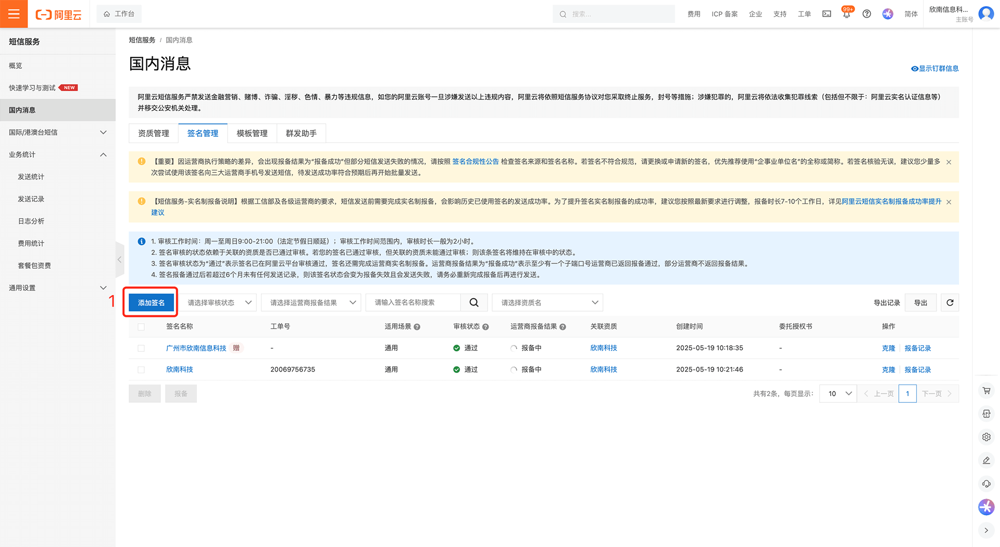
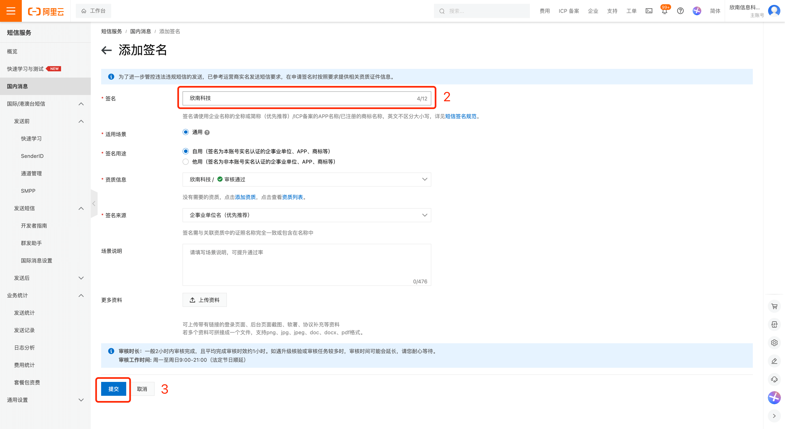
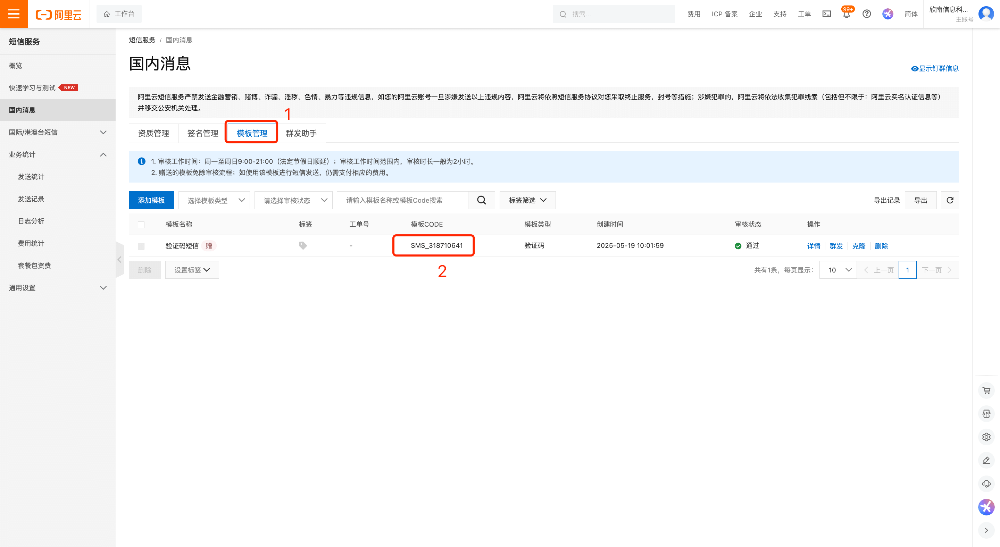
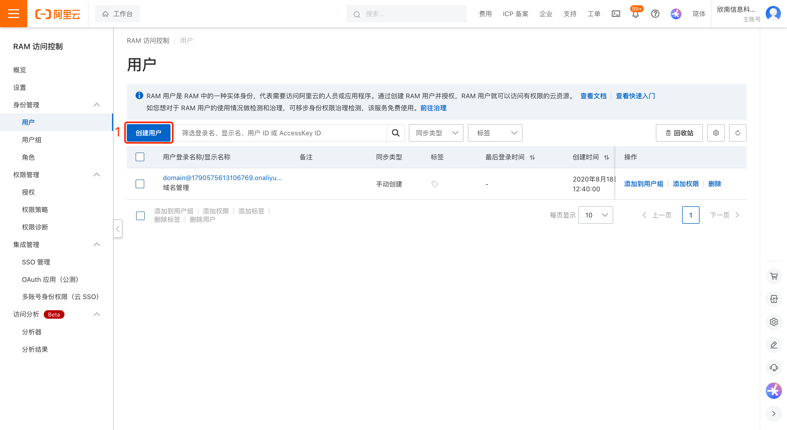
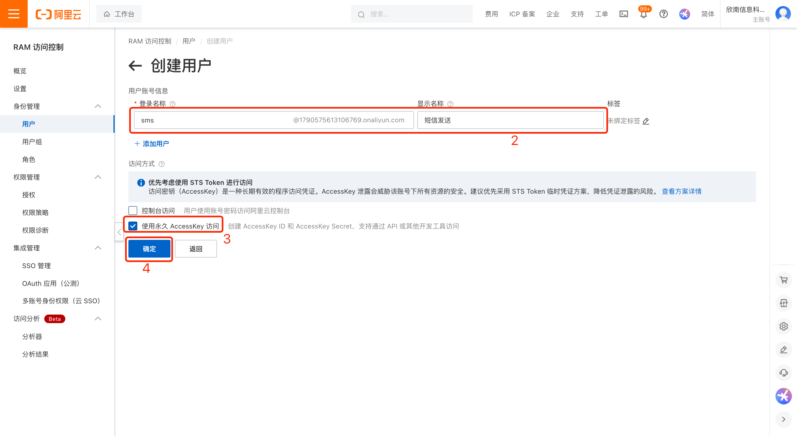
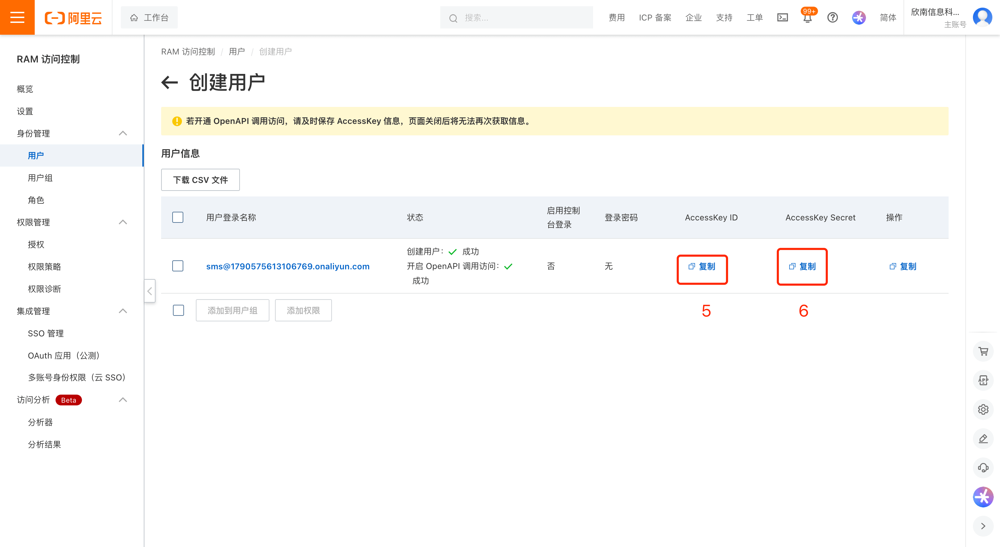
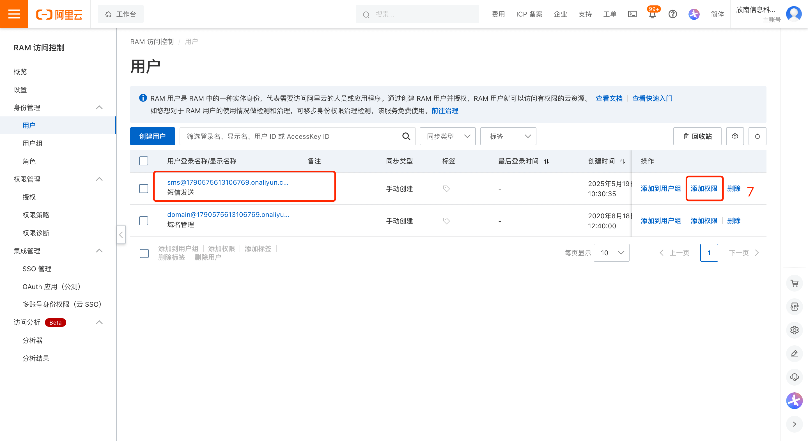
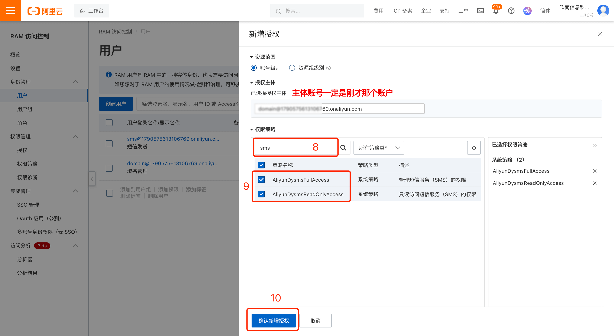
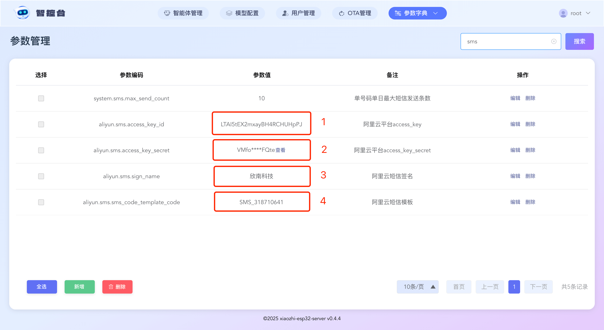
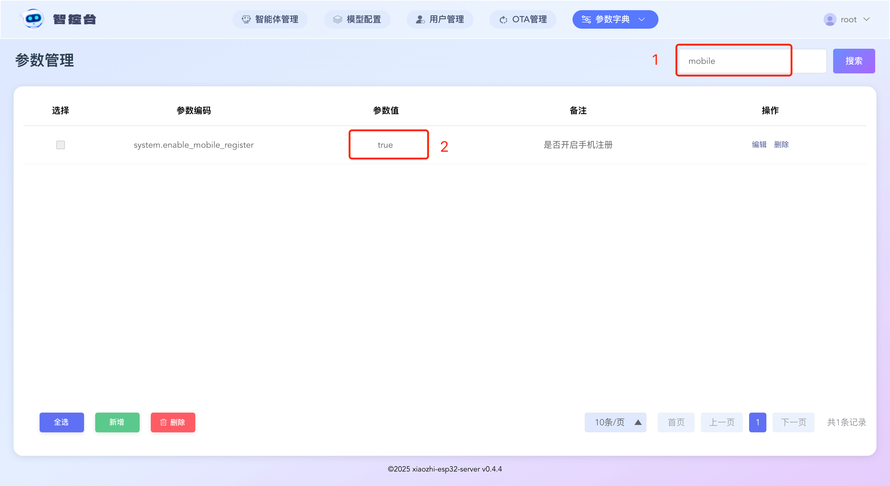

# Alibaba Cloud SMS Integration Guide

Log in to the Alibaba Cloud console and open the "SMS Service" page: https://dysms.console.aliyun.com/overview

## Step 1 Add a Signature

The steps above produce a signature. Enter it in the Control Panel parameter `aliyun.sms.sign_name`.

## Step 2 Add a Template

The steps above produce a template code. Enter it in the Control Panel parameter `aliyun.sms.sms_code_template_code`.

Note that the signature takes 7 working days; messages can be sent successfully only after carrier approval.

Note that the signature takes 7 working days; messages can be sent successfully only after carrier approval.

Note that the signature takes 7 working days; messages can be sent successfully only after carrier approval.

You can wait until approval succeeds before continuing.

## Step 3 Create an SMS Account and Grant Permissions

Log in to the Alibaba Cloud console and open the "Access Control" page: https://ram.console.aliyun.com/overview?activeTab=overview

The steps above produce an access_key_id and access_key_secret. Enter them in the Control Panel parameters `aliyun.sms.access_key_id` and `aliyun.sms.access_key_secret`.
## Step 4 Enable Phone Registration

1. Normally, once all the information above is filled in, you will see the following result. If not, a step may be missing.

2. Allow non-administrator users to register by setting the parameter `server.allow_user_register` to `true`.

3. Enable phone registration by setting the parameter `server.enable_mobile_register` to `true`.

