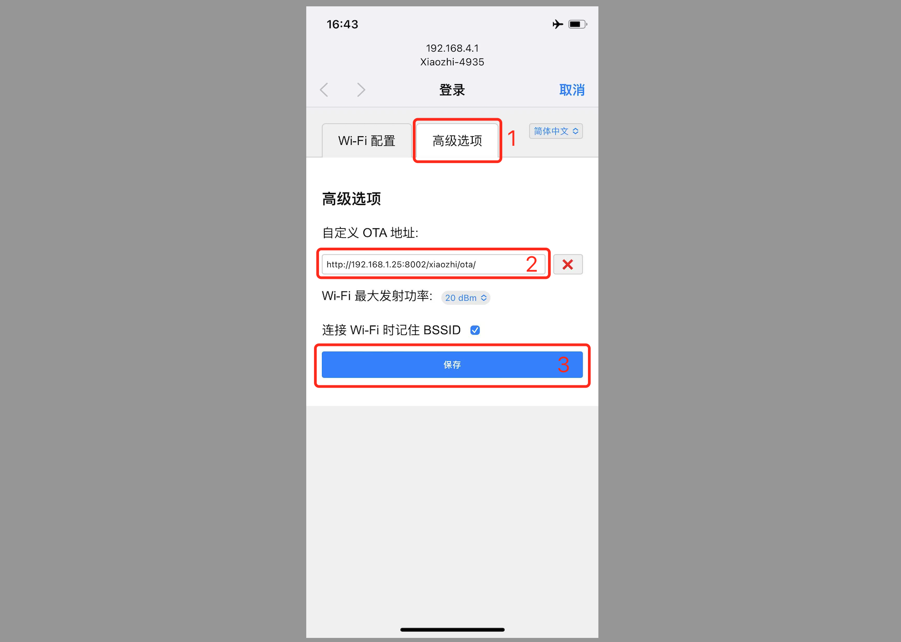

# Configure a Custom Server Based on Firmware Compiled by Brother Xia

## Step 1 Confirm the Version
Flash [firmware version 1.6.1 or later compiled by Brother Xia](https://github.com/78/xiaozhi-esp32/releases).

## Step 2 Prepare Your OTA Address
If you followed the tutorial and used a full-module deployment, you should have an OTA address.

Open your OTA address in a browser. For example, my OTA address is:
```
https://2662r3426b.vicp.fun/xiaozhi/ota/
```

If it displays "OTA endpoint is running normally. Number of websocket clusters: X", continue.

If it displays "OTA endpoint is not running normally", you probably have not configured the `Websocket` address in the `Control Panel`. Then:

- 1. Log in to the Control Panel as the super administrator.

- 2. Click `Parameter Management` in the top menu.

- 3. Find the `server.websocket` entry in the list and enter your `Websocket` address. For example, mine is:

```
wss://2662r3426b.vicp.fun/xiaozhi/v1/
```

After configuring it, refresh your OTA endpoint URL in the browser to see whether it works. If it still does not, confirm again that Websocket started normally and that the Websocket address is configured.

## Step 3 Enter Network Configuration Mode
Enter the device's network configuration mode. At the top of the page, click "Advanced Options", enter your server's `ota` address, and click Save. Restart the device.


## Step 4 Wake XiaoZhi and Check the Log Output

Wake XiaoZhi and check whether the logs appear normally.


## FAQ
Here are some common questions for reference:

[1. Why does XiaoZhi recognize a lot of Korean, Japanese, and English when I speak?](./FAQ.md)

[2. Why do I get "TTS task error: file does not exist"?](./FAQ.md)

[3. TTS often fails or times out](./FAQ.md)

[4. I can connect to the self-hosted server over Wi-Fi, but not in 4G mode](./FAQ.md)

[5. How can I improve XiaoZhi's response speed?](./FAQ.md)

[6. I speak slowly, but XiaoZhi keeps interrupting during pauses](./FAQ.md)

[7. I want to use XiaoZhi to control lights, air conditioners, remote power switches, and more](./FAQ.md)
