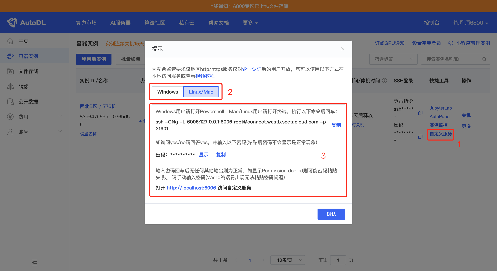
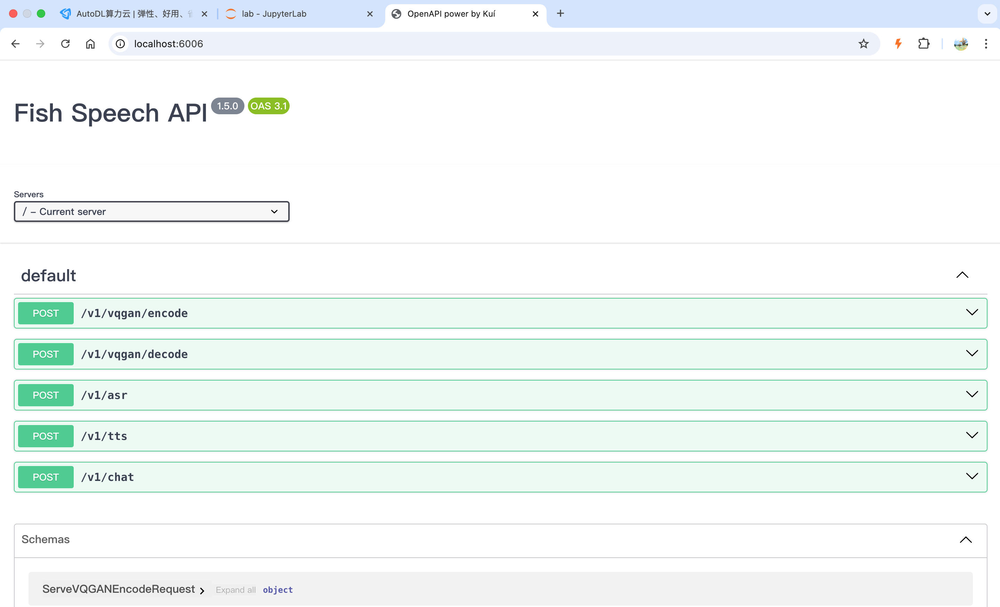

Log in to AutoDL and rent an image
Select the image:
```
PyTorch / 2.1.0 / 3.10(ubuntu22.04) / cuda 12.1
```

After the machine starts, enable academic acceleration:
```
source /etc/network_turbo
```

Enter the working directory:
```
cd autodl-tmp/
```

Pull the project:
```
git clone https://gitclone.com/github.com/fishaudio/fish-speech.git ; cd fish-speech
```

Install dependencies:
```
pip install -e.
```

If an error occurs, install portaudio:
```
apt-get install portaudio19-dev -y
```

After installation, run:
```
pip install torch==2.3.1 torchvision==0.18.1 torchaudio==2.3.1 --index-url https://download.pytorch.org/whl/cu121
```

Download the models:
```
cd tools
python download_models.py 
```

After downloading the models, start the API:
```
python -m tools.api_server --listen 0.0.0.0:6006 
```

Then open the AutoDL instance page in a browser:
```
https://autodl.com/console/instance/list
```

As shown in the figure, click the `Custom Service` button for the machine you just started to enable port forwarding.


After port forwarding is configured, open `http://localhost:6006/` on your local computer to access the fish-speech API.



If you use a server-only deployment, the core configuration is:
```
selected_module:
  TTS: FishSpeech
TTS:
  FishSpeech:
    reference_audio: ["config/assets/wakeup_words.wav",]
    reference_text: ["Hello there, I'm XiaoZhi, a Taiwanese girl with a lovely voice. So happy to meet you! What have you been up to lately? Don't forget to share something fun with me—I absolutely love hearing gossip.",]
    api_key: "123"
    api_url: "http://127.0.0.1:6006/v1/tts"
```

Then restart the service.
