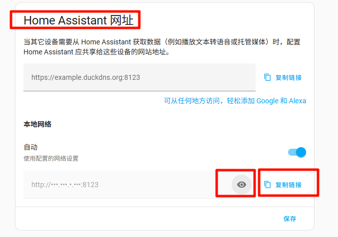
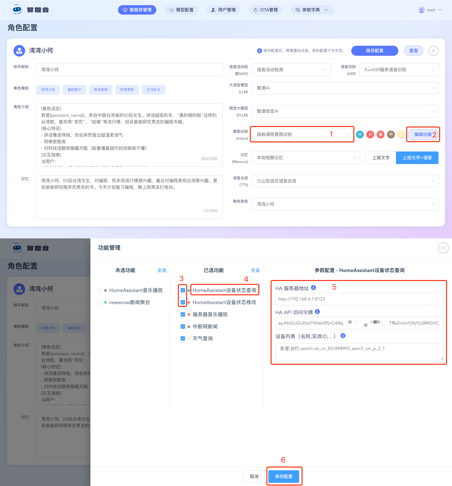
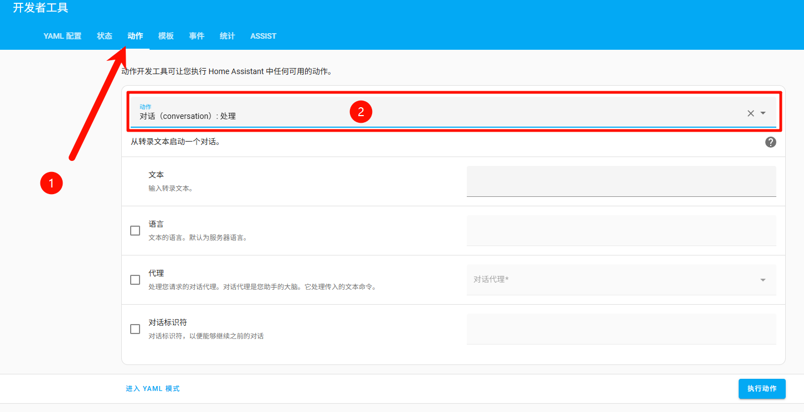
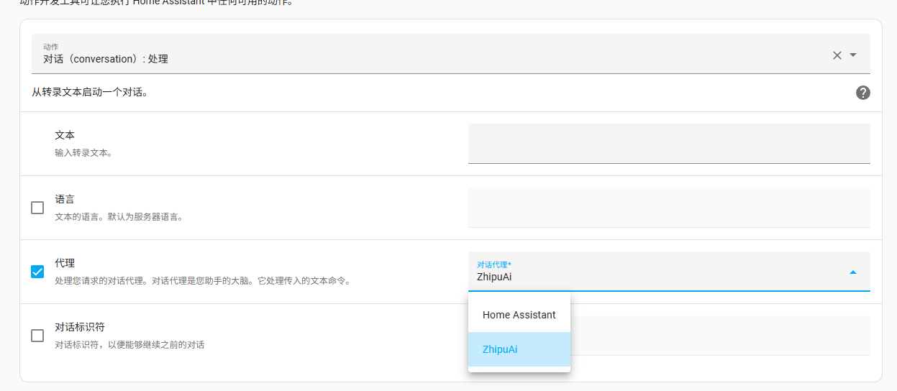
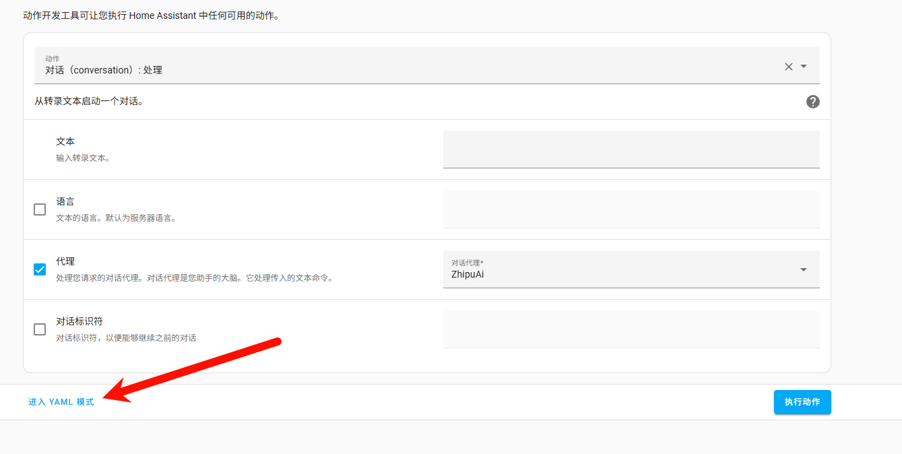
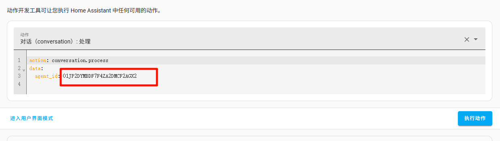

# XiaoZhi ESP32 Open-Source Server and Home Assistant Integration Guide

[TOC]

-----

## Introduction

This document guides you through integrating ESP32 devices with Home Assistant.

## Prerequisites

- `HomeAssistant` is installed and configured.
- The model I chose for this guide is the free ChatGLM, which supports function calling.

## Before You Begin (Required)

### 1. Get the Home Assistant Network Address

Open your Home Assistant network address. For example, if my HA address is 192.168.4.7 and the port is the default 8123, open the following in a browser:

```
http://192.168.4.7:8123
```

> To find HA's IP address manually **(only when the XiaoZhi esp32-server and HA are deployed on the same network device, such as the same Wi-Fi)**:
>
> 1. Open the Home Assistant frontend.
>
> 2. Click **Settings** in the lower-left corner → **System** → **Network**.
>
> 3. Scroll to the bottom to the `Home Assistant website` area. Under `local network`, click the `eye` button to see the IP address currently in use (such as `192.168.1.10`) and the network interface. Click `copy link` to copy it directly.
>
>    

Alternatively, if you have configured an OAuth address that can be accessed directly, you can open it in the browser:

```
http://homeassistant.local:8123
```

### 2. Log In to `Home Assistant` and Get a Developer Key

Log in to `HomeAssistant`, click the `avatar in the lower-left corner -> Profile`, switch to the `Security` tab, and scroll to the bottom to `Long-lived access tokens` to generate an api_key. Copy and save it; all the methods below require this api key, and it is shown only once (tip: you can save the generated QR code image and scan it later to retrieve the api key again).

## Method 1: The Community-Built HA Integration for XiaoZhi

### Feature Description

- If you need to add new devices later, this method requires manually restarting the `xiaozhi-esp32-server` to refresh device information **(important)**.

- You need to make sure `Xiaomi Home` is integrated in HomeAssistant and that Mi Home devices have been imported into `HomeAssistant`.

- You need to make sure the `xiaozhi-esp32-server Control Panel` works normally.

- My `xiaozhi-esp32-server Control Panel` and `HomeAssistant` are deployed on the same machine on different ports, with version `0.3.10`.

  ```
  http://192.168.4.7:8002
  ```


### Configuration Steps

#### 1. Log In to `HomeAssistant` and Prepare the List of Devices to Control

Log in to `HomeAssistant`, click `Settings` in the lower-left corner, go to `Devices & Services`, and then click `Entities` at the top.

Search the entities for the switches you want to control. When results appear, click one of them to open the switch's interface.

On the switch page, try toggling the switch to see whether it turns on and off with your clicks. If it works, the device is connected normally.

Then find the settings button on the switch panel and click it to view the switch's `entity ID`.

Open a text editor and prepare one entry in this format:

location + English comma + device name + English comma + `entity ID` + English semicolon

For example, I am at the office and have a toy lamp whose entity ID is switch.cuco_cn_460494544_cp1_on_p_2_1, so I write this entry:

```
Office,Toy lamp,switch.cuco_cn_460494544_cp1_on_p_2_1;
```

Of course, I may eventually want to control two lamps, so my final result is:

```
Office,Toy lamp,switch.cuco_cn_460494544_cp1_on_p_2_1;
Office,Desk lamp,switch.iot_cn_831898993_socn1_on_p_2_1;
```

Save this string, which we call the "device list string"; you will need it later.

#### 2. Log In to the `Control Panel`



Log in to the `Control Panel` with an administrator account. Under `Agent Management`, find your agent and click `Configure Role`.

Set Intent Recognition to `External LLM Intent Recognition` or `Autonomous LLM Function Calling`. You will then see an `Edit Features` option on the right. Click the `Edit Features` button to open the `Feature Management` dialog.

In the `Feature Management` dialog, check `HomeAssistant Device Status Query` and `HomeAssistant Device Status Update`.

After checking them, click `HomeAssistant Device Status Query` under `Selected Features`, then configure your `HomeAssistant` address, key, and device list string under `Parameter Configuration`.

When finished, click `Save Configuration`. The `Feature Management` dialog closes; then save the agent configuration again.

After saving successfully, you can wake the device and control it.

#### 3. Wake the Device for Control

Try saying to the ESP32, "Turn on the XXX light."

## Method 2: Use Home Assistant's Voice Assistant as an LLM Tool for XiaoZhi

### Feature Description

- This method has a fairly serious drawback: **it cannot use the function_call plugin capabilities of the XiaoZhi open-source ecosystem**, because using Home Assistant as XiaoZhi's LLM tool transfers intent recognition to Home Assistant. However, **this method lets you experience Home Assistant's native operations while keeping XiaoZhi's chat capabilities unchanged**. If that is a concern, you can use [Method 3](#method-3-use-home-assistants-mcp-service-recommended), which is also supported by Home Assistant and lets you experience Home Assistant's features to the fullest.

### Configuration Steps:

#### 1. Configure a Large Model Voice Assistant in Home Assistant.

**You need to configure Home Assistant's voice assistant or LLM tool in advance.**

#### 2. Get the Agent ID of Home Assistant's Voice Assistant.

1. Open the Home Assistant page. Click `Developer Tools` on the left.
2. In `Developer Tools`, click the `Actions` tab (operation 1 in the figure). In the `Action` field on the page, find or enter `conversation.process` and select `Conversation: Process` (operation 2 in the figure).



3. Check the `agent` option on the page, then select the voice assistant name you configured in step 1 from the now-active `conversation agent` field. As shown, mine is named `ZhipuAi`; select it.



4. After selecting it, click `Go to YAML mode` in the lower-left of the form.



5. Copy the agent-id value, for example `01JP2DYMBDF7F4ZA2DMCF2AGX2` in the figure (for reference only).



6. Open the `config.yaml` file of the XiaoZhi open-source server `xiaozhi-esp32-server`. In the LLM configuration, find Home Assistant and set your Home Assistant network address, API key, and the agent_id you just retrieved.
7. In `config.yaml`, change `LLM` under `selected_module` to `HomeAssistant` and `Intent` to `nointent`.
8. Restart the XiaoZhi open-source server `xiaozhi-esp32-server` and it is ready to use.

## Method 3: Use Home Assistant's MCP Service (Recommended)

### Feature Description

- You need to integrate and install the HA integration [Model Context Protocol Server](https://www.home-assistant.io/integrations/mcp_server/) in Home Assistant in advance.

- This method and Method 2 are both official Home Assistant solutions. Unlike Method 2, you can still use the community-built plugins of the XiaoZhi open-source server `xiaozhi-esp32-server`, and you can freely use any LLM that supports function_call.

### Configuration Steps

#### 1. Install the Home Assistant MCP Service Integration.

Official integration page: [Model Context Protocol Server](https://www.home-assistant.io/integrations/mcp_server/).

Or follow the manual steps below.

> - Go to the Home Assistant page **[Settings > Devices & Services](https://my.home-assistant.io/redirect/integrations)**.
>
> - In the lower-right corner, select the **[Add Integration](https://my.home-assistant.io/redirect/config_flow_start?domain=mcp_server)** button.
>
> - Select **Model Context Protocol Server** from the list.
>
> - Follow the on-screen instructions to complete the setup.

#### 2. Configure the MCP Settings for the XiaoZhi Open-Source Server


Go to the `data` directory and find the `.mcp_server_settings.json` file.

If there is no `.mcp_server_settings.json` file in your `data` directory:
- Copy the `mcp_server_settings.json` file from the root of the `xiaozhi-server` folder to the `data` directory and rename it to `.mcp_server_settings.json`.
- Or [download this file](https://github.com/xinnan-tech/xiaozhi-esp32-server/blob/main/main/xiaozhi-server/mcp_server_settings.json) into the `data` directory and rename it to `.mcp_server_settings.json`.


Modify this part of `"mcpServers"`:

```json
"Home Assistant": {
      "command": "mcp-proxy",
      "args": [
        "http://YOUR_HA_HOST/mcp_server/sse"
      ],
      "env": {
        "API_ACCESS_TOKEN": "YOUR_API_ACCESS_TOKEN"
      }
},
```

Notes:

1. **Replace the configuration values:**
   - Replace `YOUR_HA_HOST` in `args` with your HA service address. If your service address already includes https/http (for example `http://192.168.1.101:8123`), enter only `192.168.1.101:8123`.
   - Replace `YOUR_API_ACCESS_TOKEN` in `API_ACCESS_TOKEN` under `env` with the developer api key you obtained earlier.
2. **If the configuration you add is the last entry inside `"mcpServers"` and no new `mcpServers` entry follows, remove the trailing comma `,`**, otherwise parsing may fail.

**For reference, the final result looks like this:**

```json
 "mcpServers": {
    "Home Assistant": {
      "command": "mcp-proxy",
      "args": [
        "http://192.168.1.101:8123/mcp_server/sse"
      ],
      "env": {
        "API_ACCESS_TOKEN": "abcd.efghi.jkl"
      }
    }
  }
```

#### 3. Configure the XiaoZhi Open-Source Server

1. **Choose any LLM that supports function_call as XiaoZhi's LLM chat assistant (but do not choose Home Assistant as the LLM tool)**. The model I chose here is the free ChatGLM, which supports function calling, though it can be a little unstable at times. If you want stability, set the LLM to `DoubaoLLM` with the specific model_name `doubao-1-5-pro-32k-250115`.

2. Open the `config.yaml` file of the XiaoZhi open-source server `xiaozhi-esp32-server`, configure your LLM settings, and change `Intent` under `selected_module` to `function_call`.

3. Restart the XiaoZhi open-source server `xiaozhi-esp32-server` and it is ready to use.
