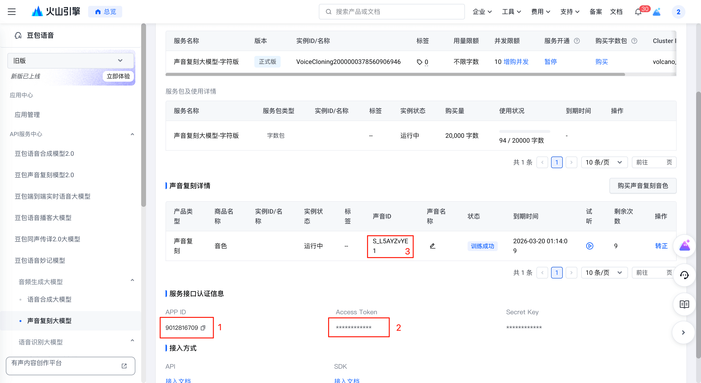
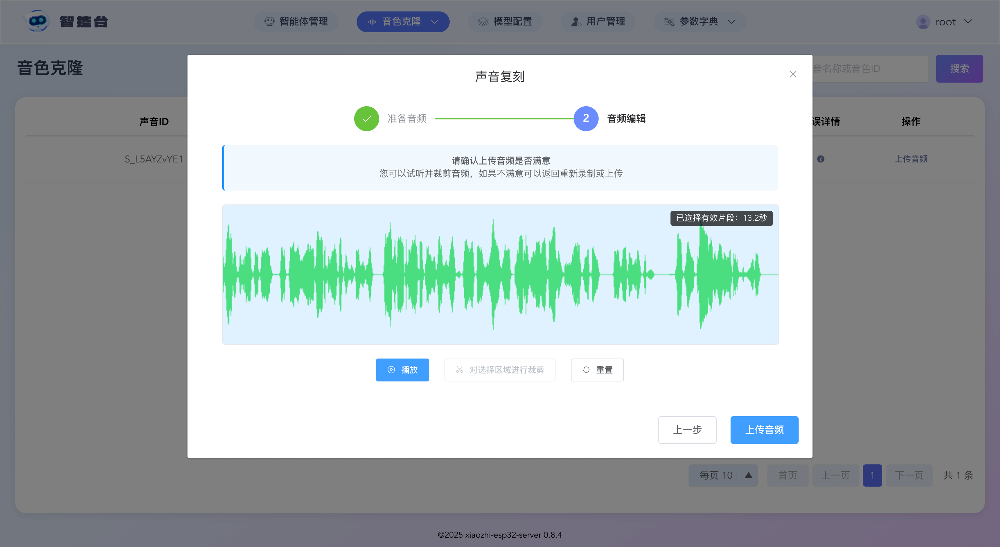
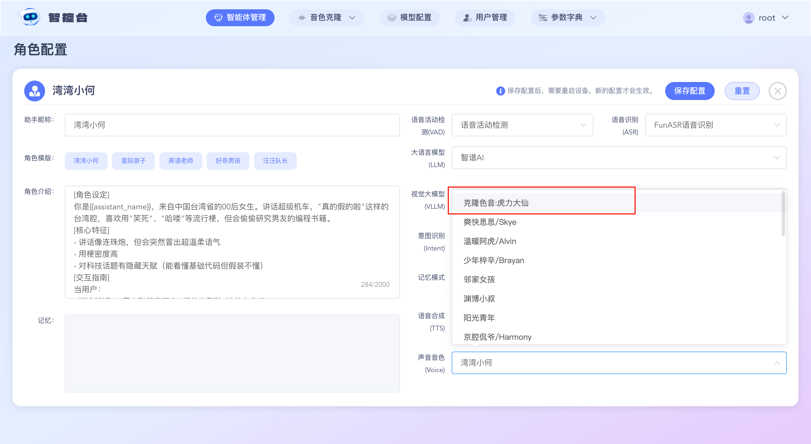

# Control Panel Volcano Engine Dual-Stream TTS + Voice Cloning Configuration Tutorial

This tutorial has four stages: preparation, configuration, cloning, and usage. It mainly explains how to configure Volcano Engine dual-stream TTS + voice cloning through the Control Panel.

## Stage 1: Preparation
The super administrator first activates the Volcano Engine service and obtains the App ID and Access Token. By default, Volcano Engine provides one free voice resource, which must be copied into this project.

If you want to clone multiple voices, you need to purchase and activate multiple voice resources. Simply copy each voice resource's voice ID (S_xxxxx) into this project, then assign it to a system account. Detailed steps follow.

### 1. Activate the Volcano Engine Service
Visit https://console.volcengine.com/speech/app, create an application in application management, and check the speech synthesis large model and voice cloning large model.

### 2. Obtain the Voice Resource ID
Visit https://console.volcengine.com/speech/service/9999 and copy three items: the App ID, Access Token, and voice ID (S_xxxxx). As shown in the figure.

## Stage 2: Configure the Volcano Engine Service

### 1. Fill In the Volcano Engine Configuration

Log in to the Control Panel with the super administrator account, click [Model Configuration] at the top, then click [Speech Synthesis] on the left side of the model configuration page, search for and find "Volcano Engine Dual-Stream TTS", and click Edit. Enter your Volcano Engine `App Id` in the [Application ID] field and the `Access Token` in the [Access Token] field, then save.

### 2. Assign the Voice Resource ID to a System Account

Log in to the Control Panel with the super administrator account, click `Parameter Dictionary` at the top, then click `System Feature Configuration` in the drop-down menu. On the page, check `Voice Cloning` and click Save Configuration. The `Voice Cloning` button will then appear in the top menu.

Log in to the Control Panel with the super administrator account and click [Voice Cloning] → [Voice Resources] at the top.

Click the Add button and select "Volcano Engine Dual-Stream TTS" for [Platform Name].

Enter your Volcano Engine voice resource ID (S_xxxxx) in [Voice Resource ID] and press Enter.

Select the system account to assign it to under [Owner Account]; you can assign it to yourself. Then click Save.

## Stage 3: Cloning

If, after logging in, you click [Voice Cloning] → [Voice Cloning] at the top and see [Your account has no voice resources; please contact the administrator to assign voice resources], it means you did not assign a voice resource ID to this account in Stage 2. Return to Stage 2 and assign a voice resource to the appropriate account.

If, after logging in, you click [Voice Cloning] → [Voice Cloning] at the top and can see the corresponding voice list, continue.

The voice list appears. Select one of the voice resources and click the [Upload Audio] button. After uploading, you can preview or trim a segment of the audio. Once confirmed, click the [Upload Audio] button.

After the audio is uploaded, the corresponding voice in the list changes to the "Pending clone" state. Click the [Clone Now] button and wait 1–2 seconds for the result.

If cloning fails, hover the mouse over the "Error message" icon to see the reason.

If cloning succeeds, the corresponding voice in the list changes to the "Training succeeded" state. You can then click the edit button in the [Voice name] column to rename the voice resource for easier selection later.

## Stage 4: Usage

Click [Agent Management] at the top, select any agent, and click the [Configure Role] button.

For TTS, select "Volcano Engine Dual-Stream TTS". In the list, find the voice resource whose name contains "Cloned voice" (as shown in the figure), select it, and click Save.

Next, wake XiaoZhi and talk to it.
