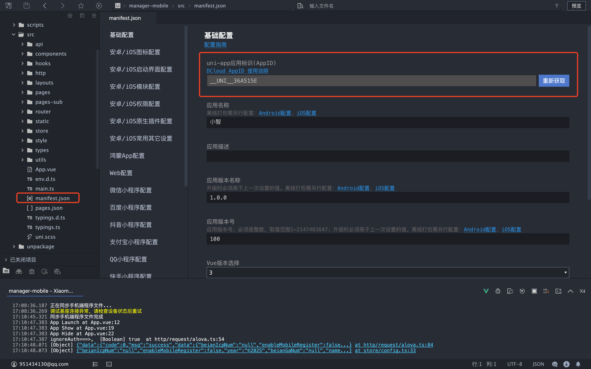
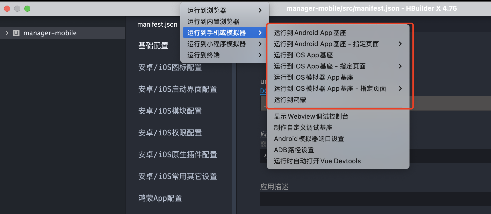
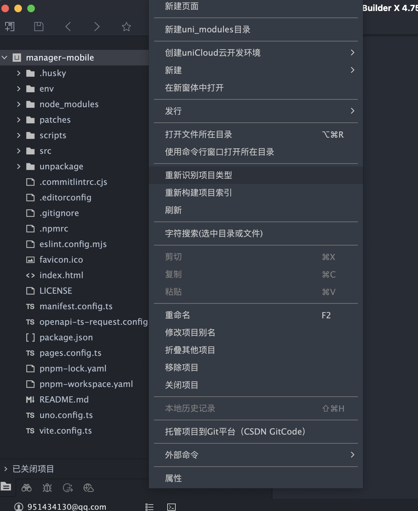
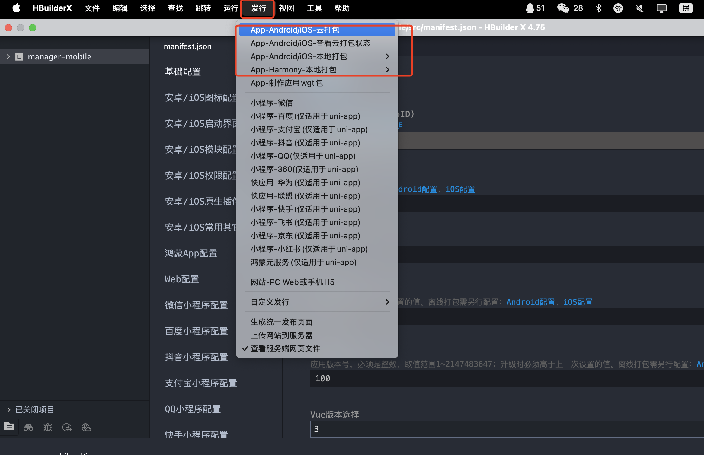
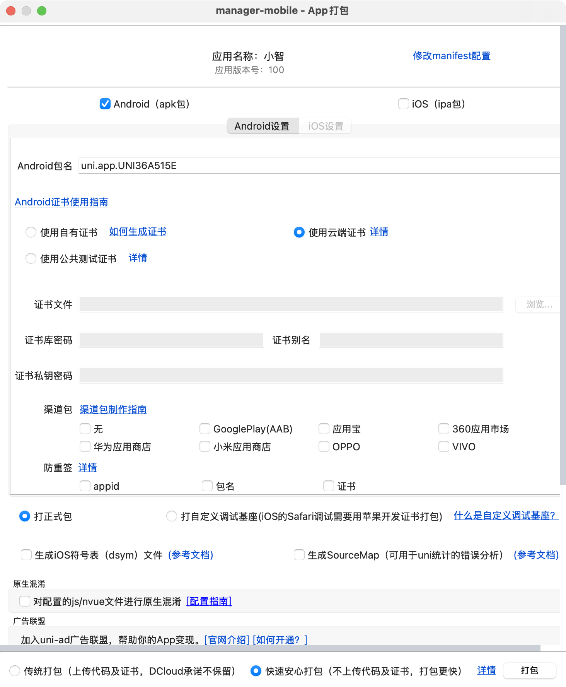

## Control Panel Mobile (manager-mobile)
A cross-platform mobile management client built with uni-app v3 + Vue 3 + Vite, supporting apps (Android & iOS) and WeChat Mini Programs.

### Platform Compatibility

| H5 | iOS | Android | WeChat Mini Program |
| -- | --- | ------- | ---------- | 
| √  | √   | √       | √          | 

Note: UI components adapt slightly differently on each platform; refer to the documentation of the corresponding component library.

### Development Requirements
- Node >= 18
- pnpm >= 7.30 (using the `pnpm@10.x` declared in the project is recommended)
- Optional: HBuilderX (app debugging/packaging), WeChat DevTools (WeChat Mini Program)

### Quick Start
1) Configure environment variables
   - Copy `env/.env.example` to `env/.env.development`
   - Adjust the settings as needed (especially `VITE_SERVER_BASEURL`, `VITE_UNI_APPID`, and `VITE_WX_APPID`)

2) Install dependencies

```bash
pnpm i
```

3) Local development (hot reload)
- H5: `pnpm dev:h5`, then check the IP and port shown in the startup log
- WeChat Mini Program: `pnpm dev:mp` or `pnpm dev:mp-weixin`, then import `dist/dev/mp-weixin` in WeChat DevTools
- App: import `manager-mobile` into HBuilderX, then follow the tutorial below to run it

### Environment Variables and Configuration
The project uses a custom `env` directory for environment files, named according to the Vite convention: `.env.development`, `.env.production`, etc.

Key variables (partial list):
- VITE_APP_TITLE: application name (written to `manifest.config.ts`)
- VITE_UNI_APPID: uni-app application appid (App)
- VITE_WX_APPID: WeChat Mini Program appid (mp-weixin)
- VITE_FALLBACK_LOCALE: default language, e.g. `zh-Hans`
- VITE_SERVER_BASEURL: server base URL (HTTP request baseURL)
- VITE_DELETE_CONSOLE: whether to remove console output at build time (`true`/`false`)
- VITE_SHOW_SOURCEMAP: whether to generate sourcemaps (disabled by default)
- VITE_LOGIN_URL: login page path for unauthenticated redirects (used by the route interceptor)

Example (`env/.env.development`):
```env
VITE_APP_TITLE=XiaoZhi
VITE_FALLBACK_LOCALE=zh-Hans
VITE_UNI_APPID=
VITE_WX_APPID=

VITE_SERVER_BASEURL=http://localhost:8080

VITE_DELETE_CONSOLE=false
VITE_SHOW_SOURCEMAP=false
VITE_LOGIN_URL=/pages/login/index
```

Notes:
- `manifest.config.ts` reads the title, appid, language, and other settings from `env`.

### Important Notes
⚠️ **Configuration that must be changed before deployment:**

1. **Application ID configuration**
   - `VITE_UNI_APPID`: create an application in the [DCloud Developer Center](https://dev.dcloud.net.cn/) and obtain the AppID
   - `VITE_WX_APPID`: register a Mini Program on the [WeChat Public Platform](https://mp.weixin.qq.com/) and obtain the AppID

2. **Server address**
   - `VITE_SERVER_BASEURL`: change this to your actual server address

3. **Application information**
   - `VITE_APP_TITLE`: change this to your application name
   - Update icon assets such as `src/static/logo.png`

4. **Other configuration**
   - Check the application settings in `manifest.config.ts`
   - Modify the tabbar configuration in `src/layouts/fg-tabbar/tabbarList.ts` as needed

### Detailed Guide

#### 1. Obtain the uni-app AppID

- Copy the generated AppID into the `VITE_UNI_APPID` environment variable

#### 2. Local Run Steps


**Local app debugging:**
1. Import the `manager-mobile` directory into HBuilderX
2. Re-identify the project
3. Connect a phone or use an emulator for on-device debugging

**Resolving project recognition issues:**


If HBuilderX cannot recognize the project type correctly:
- Right-click in the project root and select "Re-identify project type"
- Make sure the project is recognized as a "uni-app" project

### Routing and Authentication
- The route interceptor plugin `routeInterceptor` is registered in `src/main.ts`.
- Blacklist interception: only pages configured as requiring login are checked (via `getNeedLoginPages` from `@/utils`).
- Login check: based on user information (`useUserStore` from `pinia`); unauthenticated users are redirected to `VITE_LOGIN_URL`, with a parameter to redirect back to the original page.

### Network Requests
- Based on `alova` + `@alova/adapter-uniapp`; the instance is created centrally in `src/http/request/alova.ts`.
- `baseURL` comes from the environment configuration (`getEnvBaseUrl`); the domain can be switched dynamically via `method.config.meta.domain`.
- Authentication: by default, the local `token` (`uni.getStorageSync('token')`) is injected into the `Authorization` header; if missing, the user is redirected to login.
- Responses: HTTP errors with `statusCode !== 200` and business errors with `code !== 0` are handled centrally; `401` clears the token and redirects to login.

### Build and Release

**WeChat Mini Program:**
1. Make sure the correct `VITE_WX_APPID` is configured
2. Run `pnpm build:mp`; the output is in `dist/build/mp-weixin`
3. Import the project directory in WeChat DevTools and upload the code
4. Submit it for review on the WeChat Public Platform

**Android & iOS App:**

#### 3. App Packaging and Release Steps

**Step 1: Prepare for packaging**


1. Make sure the correct `VITE_UNI_APPID` is configured
2. Run `pnpm build:app`; the output is in `dist/build/app`
3. Import the project directory into HBuilderX
4. In HBuilderX, click "Release" → "Native App - Cloud Packaging"

**Step 2: Configure packaging parameters**


1. **App icon and splash screen**: upload the app icon and splash screen images
2. **App version**: set the version number and version name
3. **Signing certificate**:
   - Android: upload the keystore certificate file
   - iOS: configure the developer certificate and provisioning profile
4. **Package name**: set the application package name (Bundle ID)
5. **Package type**: choose a test build or a release build
6. Click "Package" to start the cloud packaging process

**Publishing to app stores:**
- **Android**: upload the generated APK file to the major Android app stores
- **iOS**: upload the generated IPA file to the App Store via App Store Connect (an Apple Developer account is required)

### Conventions and Tooling
- Pages and subpackages: generated centrally by `@uni-helper/vite-plugin-uni-pages` and `pages.config.ts`; tabbar configuration is in `src/layouts/fg-tabbar/tabbarList.ts`.
- Automatic component and hook imports: see `unplugin-auto-import` and `@uni-helper/vite-plugin-uni-components` in `vite.config.ts`.
- Styling: UnoCSS and `src/style/index.scss`.
- State management: `pinia` + `pinia-plugin-persistedstate`.
- Code standards: built-in `eslint`, `husky`, and `lint-staged`; code is formatted automatically before committing (`lint-staged`).

### Common Scripts
```bash
# Development
pnpm dev:mp        # equivalent to dev:mp-weixin

# Build
pnpm build:mp      # equivalent to build:mp-weixin

# Other
pnpm type-check
pnpm lint && pnpm lint:fix
```

### License
MIT
